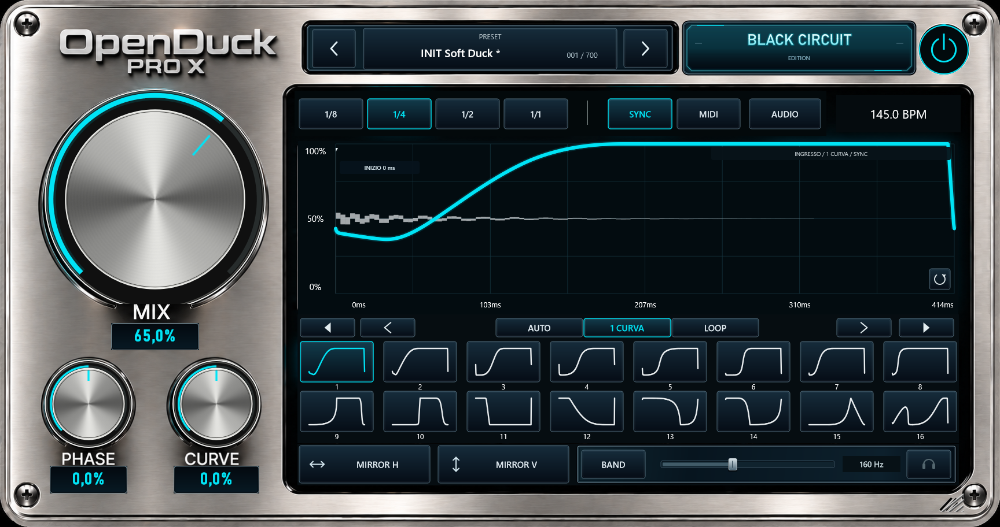

# Open Duck by Black Circuit

A free audio ducking VST3 plugin for **Windows x64**, created by David Blackstorm. Current development version: **0.4.1**, Windows installer revision **R17**.




**[Download Windows installer 0.4.1 R17](https://github.com/davidblackstorm-ai/Open-Duck/releases/download/v0.4.1-r17/Black-Circuit-Open-Duck-0.4.1-R17-Setup.exe)** | **[Complete release and source downloads](https://github.com/davidblackstorm-ai/Open-Duck/releases/tag/v0.4.1-r17)**

**[Leave feedback / volunteer for testing](https://github.com/davidblackstorm-ai/Open-Duck/issues/2)** | **[Help create the Mac version](https://github.com/davidblackstorm-ai/Open-Duck/issues/1)**
## Download and source code

Open this repository's [**Releases**](https://github.com/davidblackstorm-ai/Open-Duck/releases) section for the Windows installer, tester package and full developer source archive. The full source tree is also available directly in this repository: Source, Assets, tests, tools, installer, docs and third_party/JUCE. The developer archive provides the same development snapshot in a convenient download. The snapshot has not been freshly compiled for publication.

**No macOS build is available yet.** The complete source code and resources are provided so volunteers can modify the project, create a native Mac version and submit their changes and builds for review. Help porting, building and testing on macOS is welcome, including Apple Silicon and Intel where feasible. Open an Issue using the volunteer/macOS template to get involved. Linux compatibility is not verified.

## Help shape the next version

We are looking for beta testers, producers, musicians, sound designers, C++/JUCE developers, DSP engineers, UI/UX designers and graphic artists. Contributions are **voluntary and unpaid**; even a clear bug report or small improvement helps.

Priorities include:
- Honest reviews and practical feedback on sound, reliability, functionality and workflow.
- Reproducible DAW testing: sidechain routing, sync, MIDI/audio triggering, automation, project recall, clicks/dropouts, latency and CPU usage.
- Code review, refactoring or rewriting components, DSP improvements and performance.
- Improved interface, usability, accessibility and original graphics.
- A native macOS port and testing in Mac audio hosts.

Use [**Issues**](https://github.com/davidblackstorm-ai/Open-Duck/issues) to report bugs, suggest features or volunteer. Read CONTRIBUTING.md and TESTING.md first. Reviewed improvements can be released here with contributor credits. Positive ratings are not required; constructive criticism is welcome.

## Current features

C++17 / JUCE 8.0.9; VST3; tempo-synced, MIDI and audio-sidechain triggering; adjustable ducking curves; MIX/PHASE/CURVE and SHIFT/SLOPE controls; low-band processing; waveform visualization; 700 presets. The legacy technical bundle name is `OpenDuck Pro X.vst3`, while the host shows `Open Duck` and the manufacturer is Black Circuit.

## Status and limits

This is a development project. Existing reports describe automated checks; native DAW validation is incomplete and broad host compatibility is not established. R17 changes installer file-in-use detection and carries the same audio payload as R16. The installer is unsigned. No new audio tests or production installation were run for this publication. See KNOWN_LIMITATIONS.md and the release report.

## Build

Clone this repository or extract the developer source release archive. Windows prerequisites: Visual Studio 2022 Desktop C++, Windows SDK and CMake >=3.22. JUCE is bundled.

```powershell
cmake -S . -B build -G "Visual Studio 17 2022" -A x64
cmake --build build --config Release --target OpenDuckProX_VST3
```

The wider QA/release scripts need additional dependencies documented in the archive. macOS requires porting work; the Windows setup cannot serve as a native Mac installer.

## License and credits

The project contains an AGPL v3 license in LICENSE.txt. Preserve dependency notices and existing credits. JUCE and other dependencies retain their own license terms. David Blackstorm confirmed authorship of the graphics and authorized project publication. Contributions must include the rights needed to share and modify them under compatible terms.


